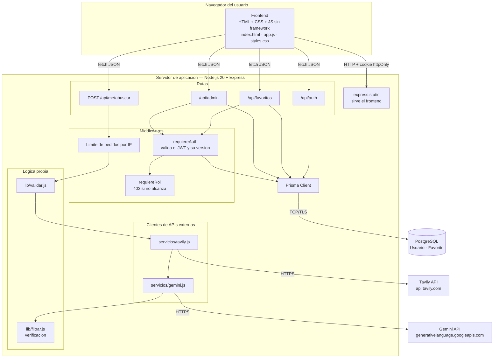
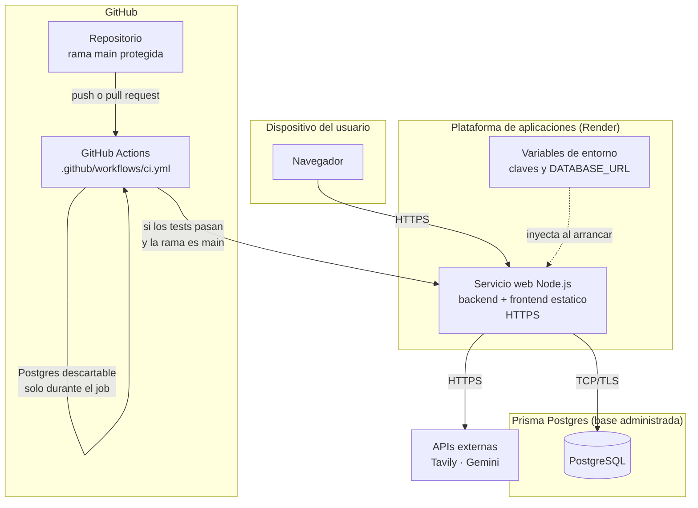

# Arquitectura y despliegue

## Diagrama de arquitectura

### Por capas

| Capa | Qué hace | Archivos |
|---|---|---|
| **Presentación** | Formulario de filtros, tarjetas de resultados, modal de sesión. Escapa todo lo que viene de internet. | `frontend/` |
| **Rutas** | Reciben el pedido, aplican límites y permisos, devuelven JSON. | `server.js`, `rutas/` |
| **Lógica de negocio** | Validación de filtros y **verificación** de los resultados del modelo. | `lib/validar.js`, `lib/filtrar.js` |
| **Integraciones** | Hablan con las APIs externas, con tiempo límite. | `servicios/` |
| **Persistencia** | Acceso a la base con Prisma. | `lib/db.js`, `prisma/` |

### Dos decisiones de arquitectura

**El frontend está acoplado al backend a propósito.** No hay build ni framework: es
HTML/CSS/JS plano que Express sirve con `express.static`, usando rutas relativas. Eso hace
que todo el proyecto se levante con un solo comando y que cualquier integrante del equipo
pueda leer el código sin aprender una herramienta nueva. Está discutido en
[decisiones-tecnicas.md](decisiones-tecnicas.md).

**Las claves viven solo en el servidor.** El navegador nunca habla con Tavily, con Gemini ni
con la base. Si el frontend tuviera las claves, cualquiera podría leerlas desde el inspector
del navegador y gastar los créditos del equipo.

---

## Diagrama de despliegue

### Entornos

| Entorno | Dónde corre | Base de datos | APIs externas |
|---|---|---|---|
| **Desarrollo** | Máquina de cada integrante | Postgres local o una base de desarrollo propia | Reales, con `TAVILY_DEPTH=basic` para gastar menos |
| **Pruebas (CI)** | Contenedor de GitHub Actions | Postgres de servicio, descartable, se destruye al terminar | **Mockeadas**: el pipeline nunca gasta créditos |
| **Producción** | Plataforma de aplicaciones | Prisma Postgres (administrada) | Reales, con `TAVILY_DEPTH=advanced` |

### El pipeline paso a paso

1. Alguien hace *push* o abre un *pull request*.
2. GitHub Actions levanta un contenedor con Node 20 y una Postgres descartable.
3. `npm ci` instala las versiones exactas del `package-lock.json`.
4. `npm run db:deploy` aplica las migraciones versionadas sobre la base de pruebas: así el
   pipeline prueba **el mismo SQL que va a correr en producción**.
5. `npm test` corre los 45 tests con el umbral de cobertura del 65 %. **Si algo falla, el
   pipeline corta acá** y no se despliega.
6. Solo si los tests pasan **y** la rama es `main`, se dispara el despliegue.

### Qué hay que configurar en la plataforma

| Variable | De dónde sale |
|---|---|
| `DATABASE_URL` | Cadena de conexión de Prisma Postgres |
| `JWT_SECRET` | Generado al azar, distinto del de desarrollo |
| `TAVILY_API_KEY` · `GEMINI_API_KEY` · `GEMINI_MODEL` | Paneles de cada servicio |
| `TAVILY_DEPTH` | `advanced` |
| `NODE_ENV` | `production` — hace que la cookie de sesión sea `secure` |

Y en GitHub, el secret `RENDER_DEPLOY_HOOK` con la URL del hook de despliegue
(Settings → Secrets and variables → Actions).

> **Antes de desplegar:** correr `npm run db:deploy` contra la base de producción, o la
> aplicación va a arrancar contra una base sin tablas.
