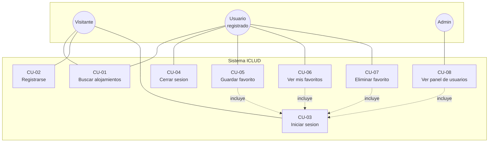

# Casos de uso

## Diagrama UML

El **Admin** es un Usuario registrado con el rol `admin`: hereda todo lo que puede hacer un
usuario normal y además accede al panel.

### Resumen

| ID | Caso de uso | Actor | Requiere sesión |
|---|---|---|---|
| CU-01 | Buscar alojamientos | Visitante / Usuario | no |
| CU-02 | Registrarse | Visitante | no |
| CU-03 | Iniciar sesión | Visitante | no |
| CU-04 | Cerrar sesión | Usuario | sí |
| CU-05 | Guardar un favorito | Usuario | sí |
| CU-06 | Ver mis favoritos | Usuario | sí |
| CU-07 | Eliminar un favorito | Usuario | sí |
| CU-08 | Ver el panel de usuarios | Admin | sí, con rol admin |

---

## CU-01 — Buscar alojamientos

*El caso de uso principal: es la razón de existir del sistema.*

| | |
|---|---|
| **Actor principal** | Visitante o Usuario registrado |
| **Precondición** | Ninguna. La búsqueda es pública. |
| **Postcondición** | Se muestran hasta 6 alojamientos verificados. **No se guarda nada.** |

### Curso normal

1. El usuario entra a la página principal.
2. Carga el destino y, si quiere, fechas de entrada y salida, cantidad de huéspedes, precio
   máximo y servicios deseados.
3. Presiona "Buscar".
4. El sistema **valida los filtros**. Si algo está mal, corta acá y avisa qué corregir.
5. El sistema arma una consulta y **busca en la web**, guardando la lista exacta de fuentes
   que recibió.
6. El sistema le pide al **modelo de lenguaje** que convierta ese texto en datos
   estructurados.
7. El sistema **verifica** cada resultado: descarta los que no correspondan a una fuente real
   de la búsqueda, elimina repetidos, corta en 6 y recorta las descripciones.
8. Muestra los resultados en tarjetas, cada una con su enlace a la fuente original.

### Cursos alternativos

| Caso | Qué hace el sistema |
|---|---|
| **4a.** Falta el destino, las fechas no tienen sentido, los huéspedes no son un número válido o se pidió un servicio desconocido | Responde **400** con el motivo exacto. **No consume créditos**: la validación va antes de llamar a las APIs. |
| **5a.** La búsqueda web no encuentra ninguna fuente | Responde **200 con una lista vacía**. No es un error: no había nada. No se llama al modelo. |
| **5b / 6a.** Una API externa falla o tarda demasiado | Responde **502** con un mensaje genérico. El detalle técnico va solo al log del servidor, nunca al usuario. |
| **7a.** El modelo devolvió resultados pero ninguno pasa la verificación | Responde **200 con una lista vacía**. Es preferible no mostrar nada antes que mostrar algo inventado. |
| **3a.** El usuario busca más de 10 veces en un minuto | Responde **429** y le pide esperar. Cada búsqueda cuesta créditos. |

---

## CU-05 — Guardar un favorito

*Es el caso de uso que justifica tener base de datos y cuentas.*

| | |
|---|---|
| **Actor principal** | Usuario registrado |
| **Precondición** | Tener sesión iniciada y un resultado de búsqueda en pantalla. |
| **Postcondición** | El alojamiento queda guardado, con su fecha de guardado. |

### Curso normal

1. El usuario hace una búsqueda (CU-01).
2. Presiona el botón de favorito en una tarjeta.
3. El sistema verifica que haya sesión válida.
4. Valida los datos: el nombre no puede estar vacío, el enlace tiene que ser `http` o
   `https`, y el precio tiene que ser texto.
5. Guarda el favorito asociado **al usuario que sale del token**, con la fecha.
6. La tarjeta queda marcada como guardada.

### Cursos alternativos

| Caso | Qué hace el sistema |
|---|---|
| **3a.** No hay sesión, o la sesión fue cerrada | Responde **401** y le ofrece iniciar sesión. |
| **4a.** El enlace no es `http`/`https` (por ejemplo `javascript:`) | Responde **400**. Es una defensa contra inyección de código. |
| **4b.** El precio viene como número en lugar de texto | Responde **400**. El precio se guarda como lo publicó la fuente. |
| **5a.** El usuario ya tenía guardado ese mismo alojamiento | No crea un duplicado: hay una restricción de unicidad por usuario y enlace. |

### Por qué el precio se guarda como texto

Las fuentes publican precios en formatos y monedas distintos: `"USD 82 por noche"`,
`"ARS 96.400"`, `"No disponible"`. Convertirlos a número obligaría a elegir una moneda y un
tipo de cambio que la fuente nunca dio, y eso sería **inventar un dato**. Se guarda el texto
tal cual, y se muestra tal cual.

La consecuencia, asumida: el sistema **no puede comparar precios** ni verificar el filtro de
precio máximo. Ese filtro funciona solo como pista para la búsqueda web.

---

## CU-08 — Ver el panel de usuarios

*Es el caso de uso que demuestra los dos niveles de acceso.*

| | |
|---|---|
| **Actor principal** | Administrador |
| **Precondición** | Sesión iniciada **con rol `admin`**. |
| **Postcondición** | Ninguna: solo lectura, no modifica nada. |

### Curso normal

1. El administrador pide el panel de usuarios.
2. El sistema verifica que haya **sesión válida** (si no: 401).
3. El sistema verifica que el usuario tenga **rol `admin`**, leyéndolo de la base de datos
   (si no: 403).
4. Devuelve la lista de usuarios con nombre, email, rol, fecha de registro y **cuántos
   favoritos guardó cada uno**.

### Cursos alternativos

| Caso | Qué hace el sistema |
|---|---|
| **2a.** No hay sesión | Responde **401**. |
| **3a.** Hay sesión pero el rol es `usuario` | Responde **403**: la diferencia importa. 401 significa "no sé quién sos"; 403, "sé quién sos y no te alcanza". |

### Dos decisiones de seguridad

1. **El rol se lee de la base en cada pedido, no del token.** Si a alguien le quitan el rol
   de admin, lo pierde en el pedido siguiente, sin esperar a que su token venza.
2. **El rol no se puede pedir al registrarse.** Quien se registra queda siempre como
   `usuario`; un admin se designa directamente en la base. Si el rol se tomara del cuerpo del
   pedido, cualquiera podría registrarse como administrador.

La consulta nunca trae el `passwordHash`: se piden explícitamente los campos a devolver, así
la contraseña no puede escaparse por la API ni por accidente.
