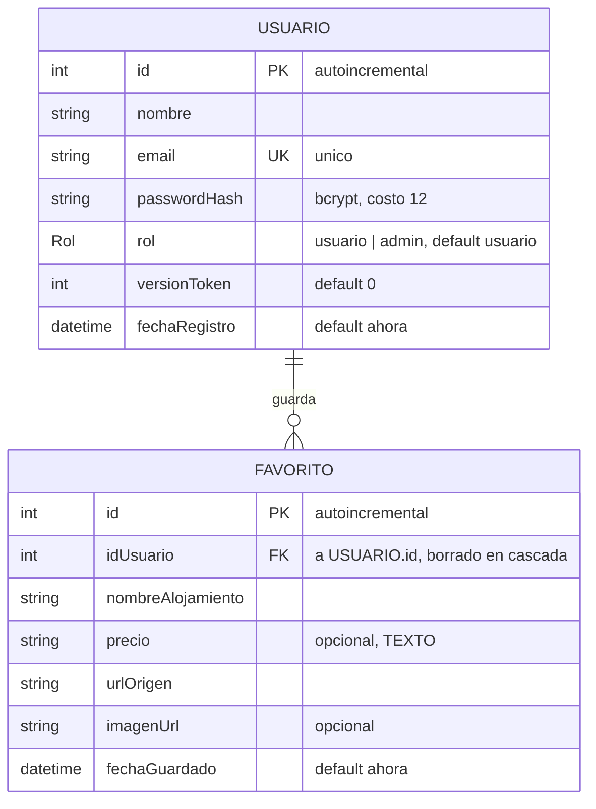

# Diagrama Entidad-Relación (DER)

Este diagrama refleja **la base de datos real**, tal como la crea
`backend/prisma/migrations/`. Cualquier cambio en el esquema tiene que actualizar también
este archivo.

Motor: **PostgreSQL**.

---

## Entidades

### USUARIO

Una persona con cuenta en el sistema.

| Campo | Tipo | Nulo | Notas |
|---|---|---|---|
| `id` | `SERIAL` | no | Clave primaria. |
| `nombre` | `TEXT` | no | Hasta 60 caracteres (lo valida la API). |
| `email` | `TEXT` | no | **Único.** Se guarda en minúsculas. |
| `passwordHash` | `TEXT` | no | Hash bcrypt con factor de costo 12. **Nunca** la contraseña en claro. |
| `rol` | `Rol` | no | Tipo enumerado: `usuario` o `admin`. Por defecto `usuario`. |
| `versionToken` | `INTEGER` | no | Por defecto 0. Permite invalidar sesiones. |
| `fechaRegistro` | `TIMESTAMP` | no | Por defecto, el momento de creación. |

### FAVORITO

Un alojamiento que un usuario decidió guardar.

| Campo | Tipo | Nulo | Notas |
|---|---|---|---|
| `id` | `SERIAL` | no | Clave primaria. |
| `idUsuario` | `INTEGER` | no | Clave foránea a `USUARIO.id`. |
| `nombreAlojamiento` | `TEXT` | no | Como lo publicó la fuente. |
| `precio` | `TEXT` | **sí** | **Texto, no número.** Ver más abajo. |
| `urlOrigen` | `TEXT` | no | Enlace a la fuente original. |
| `imagenUrl` | `TEXT` | sí | Solo si la imagen vino de la búsqueda. |
| `fechaGuardado` | `TIMESTAMP` | no | Por defecto, el momento de guardado. |

---

## Relaciones y restricciones

| Tipo | Detalle |
|---|---|
| **Cardinalidad** | Un `USUARIO` guarda **cero o muchos** `FAVORITO`. Un `FAVORITO` pertenece a **exactamente un** `USUARIO`. |
| **Borrado en cascada** | Si se borra un usuario, se borran sus favoritos. No quedan favoritos huérfanos. |
| **Único: `email`** | No puede haber dos cuentas con el mismo email. |
| **Único: (`idUsuario`, `urlOrigen`)** | Un usuario no puede guardar dos veces el mismo alojamiento. Dos usuarios **sí** pueden guardar el mismo. |

---

## Tres decisiones de modelado que conviene poder explicar

### 1. Los resultados de búsqueda no están en el modelo

No hay tabla de búsquedas ni de resultados, y es deliberado. Cada búsqueda refleja la web en
ese momento; guardarla significaría mostrar precios vencidos más adelante. Lo único que se
persiste es lo que el usuario eligió guardar.

### 2. `precio` es texto y acepta nulo

Las fuentes publican el precio en formatos y monedas distintos. Guardarlo como número
exigiría elegir una moneda y un tipo de cambio que la fuente no dio: sería inventar un dato.
Se guarda el texto tal cual (`"USD 82 por noche"`, `"ARS 96.400"`, `"No disponible"`).

**Consecuencia asumida:** no se pueden comparar ni ordenar precios en la base.

### 3. `versionToken` en lugar de una tabla de sesiones

Para que cerrar sesión invalide el token de verdad hacían falta dos caminos posibles: una
tabla de tokens revocados, o un número de versión en el usuario.

Se eligió el número porque resuelve el problema con **un campo y ninguna tabla nueva**: el
token lleva adentro la versión con la que se emitió, el logout incrementa la de la base, y
desde ese momento los tokens viejos no coinciden y dejan de valer. Una tabla de revocados
habría requerido además una limpieza periódica de registros vencidos.

**Consecuencia asumida:** el logout cierra **todas** las sesiones de ese usuario, en todos
sus dispositivos, no solo la del navegador actual. Para este proyecto es aceptable, y
posiblemente hasta lo más deseable.
