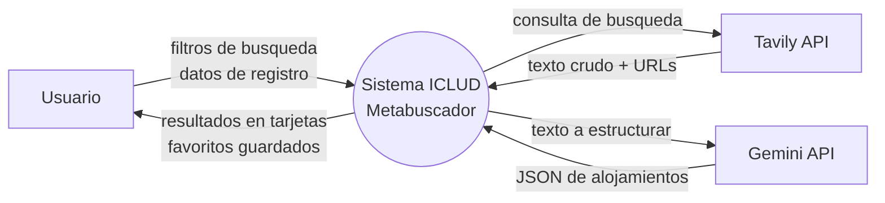
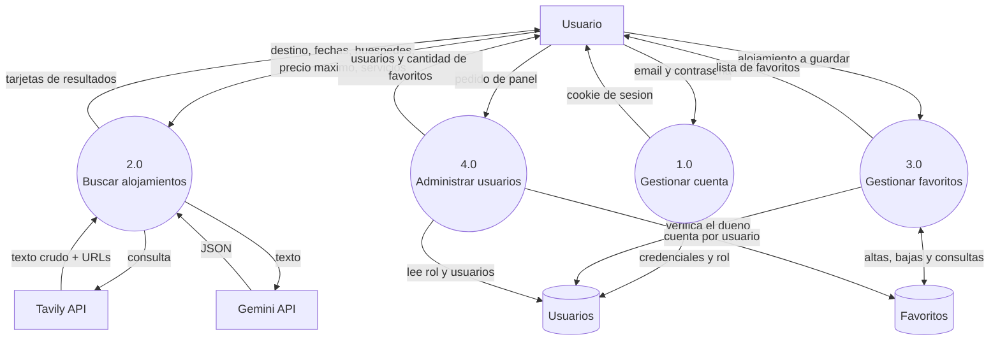
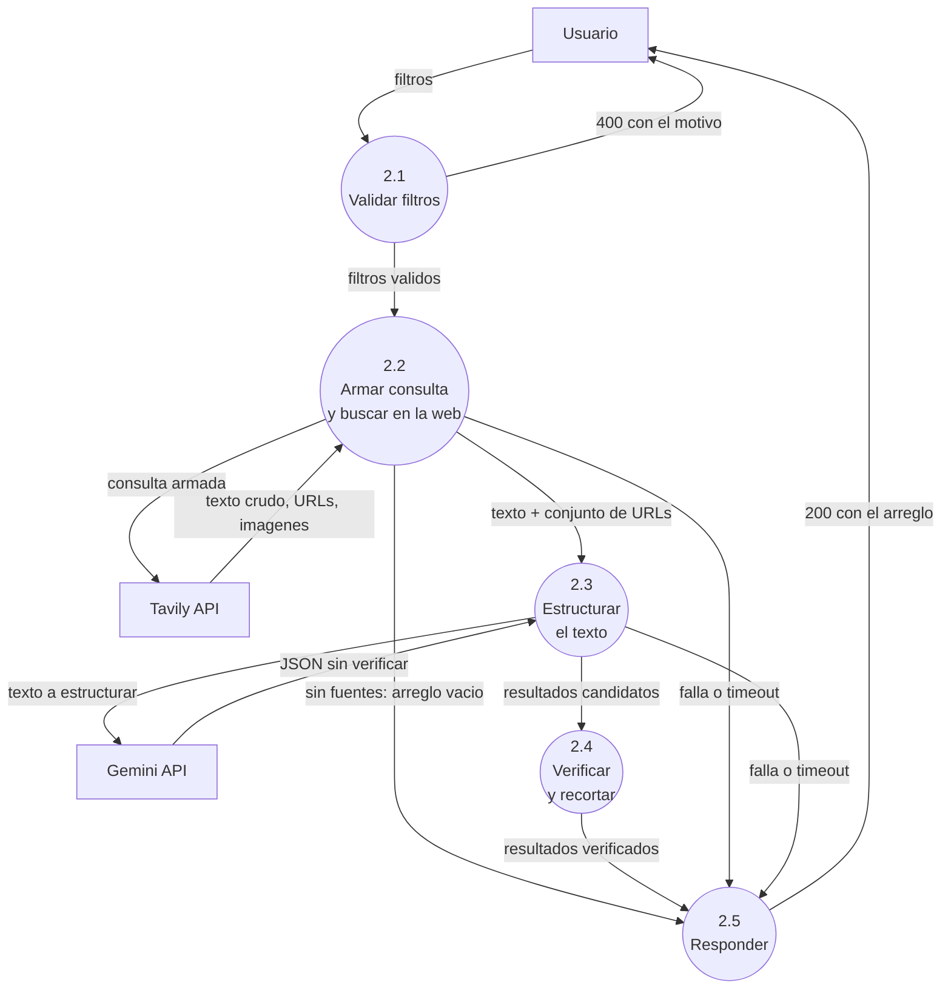

# Diagramas de Flujo de Datos (DFD)

Los diagramas están escritos en Mermaid, que GitHub dibuja automáticamente al abrir el
archivo.

Convención usada:
- **Entidad externa** (rectángulo): algo de afuera del sistema que le manda o recibe datos.
- **Proceso** (óvalo): transformación que hace el sistema.
- **Almacén** (cilindro): donde quedan guardados los datos.

---

## Nivel 0 — Diagrama de contexto

Muestra el sistema como una sola caja y con quién habla.

**Lo importante:** el usuario nunca habla con Tavily ni con Gemini. Todo pasa por el
backend, que es el único que tiene las claves.

---

## Nivel 1 — Procesos principales

Abre la caja del nivel 0 en los cuatro procesos del sistema.

**Notar que el proceso 2.0 no escribe en ningún almacén.** Es a propósito: los resultados de
una búsqueda no se guardan, para que nunca se muestren precios vencidos. Solo se guarda lo
que el usuario elige como favorito, en el proceso 3.0.

---

## Nivel 2 — Detalle del proceso 2.0 "Buscar alojamientos"

Es el proceso central del sistema, así que se abre en sus cinco subprocesos.

### Qué hace cada subproceso

| # | Subproceso | Archivo | Responsabilidad |
|---|---|---|---|
| 2.1 | Validar filtros | `lib/validar.js` | Revisa destino, fechas, huéspedes, precio y servicios. Si algo está mal devuelve **400 con el motivo**, y no se gasta ni un crédito. |
| 2.2 | Buscar en la web | `servicios/tavily.js` | Arma la consulta con los filtros y la manda a Tavily. Devuelve el texto crudo y el **conjunto exacto de URLs** que la web entregó. |
| 2.3 | Estructurar el texto | `servicios/gemini.js` | Le pide a Gemini convertir el texto en JSON, con un esquema de respuesta fijo. |
| 2.4 | Verificar y recortar | `lib/filtrar.js` | **El control de calidad.** Descarta todo resultado cuya URL no esté en el conjunto del paso 2.2, saca duplicados, corta en 6 resultados y recorta las descripciones a 25 palabras. |
| 2.5 | Responder | `server.js` | Arma la respuesta: 200 con el arreglo, o 502 genérico si falló una API externa (el detalle va solo al log). |

### Por qué el paso 2.4 existe

Un modelo de lenguaje puede inventar datos que suenan plausibles. Si publicáramos su
respuesta tal cual, el usuario podría ver un hotel que no existe con un precio que nadie
ofreció.

El paso 2.4 resuelve eso sin confiar en el modelo: **compara cada URL contra la lista exacta
que devolvió la búsqueda web.** Un alojamiento inventado no tiene URL real, así que se cae
ahí. Lo mismo con las imágenes.
